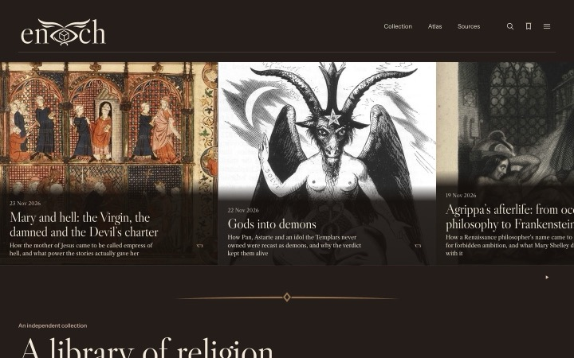
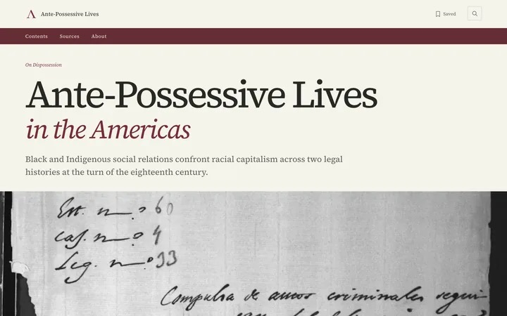
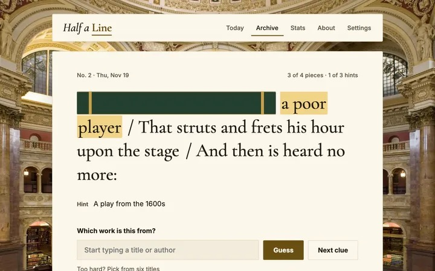

<picture>
  <source media="(prefers-color-scheme: dark)" srcset="images/avatar-dark.svg">
  
</picture>

# Andrew Cao

I study English and religion at Penn and design websites for close reading.

<table>
<tr>
<td width="33%" valign="top"> <b><a href="https://enoch.andrewcao.org/">Enoch</a></b> A library of religion that leads from short guides to primary texts, with an atlas and more than 300 sources.</td>
<td width="33%" valign="top"> <b><a href="https://acao-boop.github.io/ante-possessive-lives/">Ante-Possessive Lives in the Americas</a></b> Two colonial legal histories, from New England and Yucatán, read beyond possession. Penn PURM 2026, directed by Professor David Kazanjian.</td>
<td width="33%" valign="top"> <b><a href="https://halfaline.andrewcao.org/">Half a Line</a></b> A daily literature game. Name the work behind one famous line in as few clues as you can.</td>
</tr>
</table>

More at [andrewcao.org](https://andrewcao.org/).

Probably building a library.
